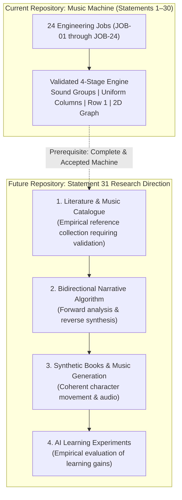

# Music Project: Sound Groups, Fundamental Columns, and Musical Expression

> **A Collaborative Reference for the Author, ChatGPT, and Google Antigravity**  
> **Repository:** `IWatchSheep/music`  
> **Documentation Status:** Consolidated README approved by the author, ChatGPT, and Google Antigravity.  
> **Consolidated Documentation Reference:** `b4285c1`  
> **Historical Implementation Baseline:** `ad3a9d3` (91 automated baseline tests passing)  
> **Protected Calculator Repository:** `17be078d` (unmodified, 100% read-only)

---

## Section 1 — Project Introduction

This project investigates an original theory of musical architecture conceived by the author.

The author proposes representing music as **distinct groups of sound** unfolding in rows and time columns. This is a research model, not a claim that conventional music theory lacks grouping or phrasing. The following is the current design specification, with empirical hypotheses identified separately:

1. **Independent Uniform Row Structures (Statements 28–30):**
   - Row 2 has its own uniform column width ($w_2$), fitted to the entire set of sounds in Row 2.
   - Row 3 independently has its own uniform column width ($w_3$), fitted to the entire set of sounds in Row 3. Its width may differ from Row 2's width.
   - Within each temporary row, column width is internally consistent, not arbitrarily fluctuating between wide and narrow.
2. **The Merger Operation (Stage B):**
   - Rows 2 and 3 merge using their respective independently fitted uniform column structures.
   - The merger produces **uniform columns** that fit the sounds of both rows, without altering authentic source musical timing.
3. **Constant Row 1 (Stage C):**
   - The resulting uniform columns are carried into constant Row 1.
   - Row 1 does not impose its column width on the temporary rows before they merge; rather, Row 1 receives the merged uniform structure.
4. **Terminal Two-Dimensional Row-to-Column Graph (Stage D):**
   - Row 1 uses its resulting row-and-column structure in a two-dimensional graph to express the terminal low-to-high progression.
   - The column size of Row 1 can differ from one piece of music to another.
   - The author proposes that this graph reveals a straight linear low-to-high progression in one piece and a curved low-to-high progression in another.
   - *"then that is the end."* This 2D graph is the intended endpoint of the architectural process.
5. **Fundamental Reference Grid (Statement 18):**
   - Within any given piece, a finer shared reference grid of equal base cells ($u$, e.g., $100\text{ ms}$) can be used to express timing and subdivisions without destructive snapping. This reference grid does not replace each temporary row's native uniform column structure.
6. **Journey ($1 + 1$) and Terminal Outcome ($= 2$):**
   - Rows 2 and 3 represent the developmental journey ($1 + 1$ or $a + b$).
   - Row 1 represents the goal, target, or harvest ($= 2$), associated with the low-to-high sound heard in *Ride of the Valkyries*.
   - Statement 23 explicitly locates this low-to-high sound as a **localized terminal punctuation mark** at the very tail end of an action (analogous to an animal finishing scratching an itch), rather than a continuous slope across the entire journey.
   - The author proposes representing the outcome at Point B as `bool = true` (win/harvest/success) or `bool = false` (disappointment/sad "aww" sound). No acoustic or emotional classification rule is established.

---

### Reading rules for future contributors

Statements 23 and 28–30 resolve the earlier misunderstandings. Read all 31 statements (Statements 1–30 for the current visual music machine and Statement 31 for future research direction), but use later author clarifications when an earlier interpretation conflicts. Preserve earlier original wording. The design requirements are agreed; mathematical and musical validation is not. Do not ask the author to repeat documented concepts or restart a settled architectural discussion. Resolve technical uncertainties through documented investigation only after experimental work is authorized.

---

## Section 2 — The Author's 31 Original Statements

The following 31 statements are drawn directly from the authoritative source file `music.txt`.
- **Statements 1–30:** Define the mathematical model, design requirements, and engineering scope for the current Visual Music Machine repository (Sections 3–9).
- **Statement 31:** Defines a proposed future research direction and subsequent repository application (Section 10).

Each statement is presented in three parts:
- **A. Original Statement — Author's Exact Words:** Copied verbatim without alterations, omissions, or spelling corrections.
- **B. Grammar-Corrected Version:** Rewritten for grammatical clarity while strictly preserving the author's meaning and terminology.
- **C. Interpretation — Author’s Design and Research Status:** A reading of the statement in light of later clarifications. Assistant hypotheses are explicitly labeled `"I guess ..."`.

---

### Statement 1

#### A. Original Statement — Author's Exact Words
> "with music if you use rows and columns. you have loops of sound that's repeated. then you have other sound that's repeated. they all fit into the time the sound is played. if the time the sound is played is split into columns then the row can hold the chunks of sound"

#### B. Grammar-Corrected Version
> With music, if you use rows and columns, you have loops of sound that repeat, alongside other sounds that repeat. All of them fit into the duration during which the sound is played. If the playback duration is divided into columns, then each row can hold those chunks of sound.

#### C. Interpretation — Author’s Design and Research Status
The author proposes arranging repeated and other sound chunks in horizontal rows, with columns representing time. The method of assigning sounds to rows remains open; a row is not necessarily an instrument, pitch register or character.

---

### Statement 2

#### A. Original Statement — Author's Exact Words
> "i was thinking of constant columns to show the time the music is played. then filling in the columns with sound that belongs in groups. then the single group goes through the row and columns and then it goes to a different group and there might be a single column that stays in the two groups maybe in a separate row where like math we join rows the row with the constant sound between groups stays in the columns with sound each loop and the next row is the group filling the columns with sound unique to the group. then you could have the row with the sound in every row be constant but the group be temporary for the time the group is played."

#### B. Grammar-Corrected Version
> I was thinking of constant columns to show the time during which music is played, and then filling those columns with sounds that belong in groups. A single group moves through the row and columns, and then transitions to a different group. A single column might stay constant between two groups—perhaps in a separate row where, like in mathematics, we join rows together. The row holding the constant sound between groups remains in the columns across each loop, while the next row contains groups filling the columns with sounds unique to that group. Thus, the row with sound in every column remains constant, while the groups are temporary for the duration they are played.

#### C. Interpretation — Author’s Design and Research Status
Temporary rows hold distinct sound groups. Constant Row 1 represents a connection between them; it need not be a continuously sounding note. Statements 28–30 specify the order of independent fitting, merger and transfer.

---

### Statement 3

#### A. Original Statement — Author's Exact Words
> "the constant sound could be the style or feeling scary or happy jaws in water or valkyries in the sky sound, not just a constant sound in every row. that binds the rows together."

#### B. Grammar-Corrected Version
> The constant sound could be the style or feeling—scary or happy, Jaws in water or Valkyries in the sky sound—not just a constant sound in every row. That binds the rows together.

#### C. Interpretation — Author’s Design and Research Status
The author proposes a shared style, feeling or identity that binds groups, not necessarily a repeated pitch. The structural merger is specified in Statements 28–30; whether it captures expressive identity is a separate unverified hypothesis.

---

### Statement 4

#### A. Original Statement — Author's Exact Words
> "i think the constant row is created by the temporary rows. the temporary rows create a linear graph line when the music is not blended with other kinds of musical styles but when its joined with multiple musical styles the constant graph line changes from linear to curved. this is why modern music is curved constant line but traditional rock music like led zeplin stairway to heaven or the beach boys or old fashioned music like that has a linear constant line and modern rap and music has a curved constant line. but to see how the musical rows that are temporary function to create this difference in the constant musical row idk how to do yet."

#### B. Grammar-Corrected Version
> I think the constant row is created by the temporary rows. These temporary rows create a linear graph line when the music is not blended with other kinds of musical styles; however, when multiple styles join together, the constant graph line shifts from linear to curved. This is why modern music has a curved constant line, whereas traditional rock music (such as Led Zeppelin's *Stairway to Heaven*, the Beach Boys, or older music) has a linear constant line, and modern rap and blended music have a curved constant line. Exactly how the temporary musical rows function to create this difference in the constant musical row, I do not know how to do yet.

#### C. Interpretation — Author’s Design and Research Status
The author hypothesizes that unblended and blended music differ in the straight or curved shape of constant Row 1. The named genres and pieces are illustrative examples, not established classifications. Statement 30 specifies the graph as the endpoint.

---

### Statement 5

#### A. Original Statement — Author's Exact Words
> "i think music that's able to go low to high is traditional, but a music that has to go low stay low on the time line to go high is a mixture of musical styles. counting columns and rows the traditional music can go low row to single column but a mixture of musical style has to go several columns to go as low. then you count the temporary rows to find the column count on how row to column low to high is measured."

#### B. Grammar-Corrected Version
> I think music that is able to move directly from low to high is traditional, whereas music that must stay low on the timeline before rising represents a mixture of musical styles. Counting columns and rows, traditional music can move from a low row across a single column, but a mixture of musical styles must traverse several columns to reach that depth. You then count the temporary rows to determine the column count for how the row-to-column progression from low to high is measured.

#### C. Interpretation — Author’s Design and Research Status
The author proposes comparing how many columns are involved in moving from low to high, including dwelling low before rising. No genre rule, definition of low, or metric is established. Statement 23 confines the low-to-high ending to the tail of an action.

---

### Statement 6

#### A. Original Statement — Author's Exact Words
> "classical music ride of  valkyries has the sound of low to high. the orchestrator swinging his stick would show that sound easily i think."

#### B. Grammar-Corrected Version
> Classical music, such as *Ride of the Valkyries*, has that low-to-high sound. A conductor swinging their baton would illustrate that sound easily, I think.

#### C. Interpretation — Author’s Design and Research Status
The author identifies *Ride of the Valkyries* as an illustrative reference for low-to-high sound and proposes conductor motion as a way to visualize it. No measured conductor trajectory or analysis of the composition is claimed.

---

### Statement 7

#### A. Original Statement — Author's Exact Words
> "the columns of time from low row to high row is made by the temporary rows. but the number of columns is not static its able to be changed by the temporary rows to fit the sound of the temporary rows. look at the temporary rows music is groups of sound that fit together, these create the columns that the row that is constant goes from low to high and because the columns are changed by the temporary rows one classical traditional column might be smaller than a mixed column made from modern music."

#### B. Grammar-Corrected Version
> The columns of time from low row to high row are created by the temporary rows. The number of columns is not static; it can be changed by the temporary rows to fit their sound. Looking at the temporary rows, music consists of groups of sound that fit together. These create the columns through which the constant row progresses from low to high. Because columns are refitted by the temporary rows, a classical or traditional column might be smaller than a mixed column in modern music.

#### C. Interpretation — Author’s Design and Research Status
Temporary rows determine the column structure of Row 1. Each temporary row first has its own uniform width; the merger produces uniform columns that fit both rows. Different songs can have different resulting widths or counts. No direction of the difference is established empirically.

---

### Statement 8

#### A. Original Statement — Author's Exact Words
> "the sound in the row is made from linked columns the beginning column the ending column hold the sound the columns fit the temporary rows together. these columns fit together to create the constant row column size."

#### B. Grammar-Corrected Version
> The sound within a row is formed from linked columns: the beginning column and ending column contain the sound, fitting the temporary rows together. These columns combine to establish the column dimensions of the constant row.

#### C. Interpretation — Author’s Design and Research Status
Sounds occupy spans within a row. The author proposes that the column systems of temporary rows fit together to establish Row 1. Individual sound onsets and offsets are not automatically Row 1 boundaries.

---

### Statement 9

#### A. Original Statement — Author's Exact Words
> "you should ask google antigravity for help coming up with a plan. first there is the temporary sounds that fit columns and these columns fit the constant row and constant row is compared to constant row to find the column different with less = linear and more = curved graph. but before all that we need to use the rows and columns and for that maybe we need to reuse the calculator project. to get the gui and rows and columns. just add a musical variation on it to plug in music to the rows and columns."

#### B. Grammar-Corrected Version
> You should ask Google Antigravity for help coming up with a plan. First, there are the temporary sounds that fit columns, and these columns fit the constant row. Constant row is then compared to constant row to find the column difference, with less meaning a linear graph and more meaning a curved graph. But before all that, we need to use the rows and columns, and for that maybe we need to reuse the calculator project to get the GUI and rows and columns, just adding a musical variation on it to plug in music to the rows and columns.

#### C. Interpretation — Author’s Design and Research Status
The author proposes a development plan: build a row-and-column interface, fit temporary rows, derive Row 1 and compare pieces. The calculator is a read-only reference at `17be078d`. A historical GUI exists, but the current four-stage architecture is not yet implemented and validated.

---

### Statement 10

#### A. Original Statement — Author's Exact Words
> "i think the rows are supposed to be many many columns wide and in those many columns we fill in the sounds hear from the music playing. the idea is the number of columns functions with the musical sheet music. i look at the rows now and they are not many columns and the columns are not aligned."

#### B. Grammar-Corrected Version
> I think the rows are supposed to be many, many columns wide, and across those many columns we fill in the sounds heard from the music playing. The idea is that the number of columns corresponds with the musical sheet music. Looking at the rows now, they do not have many columns, and the columns are not aligned.

#### C. Interpretation — Author’s Design and Research Status
The author wants enough columns to hold the sounds in the piece and to represent their alignment. Historical master-grid alignment is a baseline feature, not proof that the independently fitted row systems or their merger are solved.

---

### Statement 11

#### A. Original Statement — Author's Exact Words
> "the row 2 makes columns fit the music group. row 3 makes the columns refit the musical group. then row 1 fits rows 1 and 2 musical group. music 2 repeats the process making row 1 a different number of columns. in both music songs the columns fit rows 1, 2, 3, but not across music songs. this way you can measure the linear and curved by seeing the traditional vs the non-traditional/modern, to see the column number reasoning the columns fit together across constant rows but they don't share the linear or curved structure."

#### B. Grammar-Corrected Version
> Row 2 creates columns to fit its musical group. Row 3 then refits the columns to fit its own musical group. Then Row 1 fits the musical groups of Rows 2 and 3 [clarified by the author in Statements 28–30; original statement retained]. Song 2 repeats the process, giving its Row 1 a different number of columns. In both songs, the columns fit Rows 1, 2, and 3, but not across different songs. This way you can measure linear versus curved by seeing traditional versus non-traditional/modern music, to see the column number reasoning where columns fit together across constant rows, but they do not share the same linear or curved structure.

#### C. Interpretation — Author’s Design and Research Status
Statements 28–30 resolve the intended order: independently fit Rows 2 and 3, merge their structures into uniform columns that fit both rows, then transfer the result into Row 1. Each piece establishes its own structure; no common cross-song width is imposed. The original row-number wording is preserved.

---

### Statement 12

#### A. Original Statement — Author's Exact Words
> "the idea is row 1 is constant and goes into different rows as row addition so the columns blend music together. then column numbers in rows 2 and 3 etc setup the column size for row 1. then to show the difference between modern and classical traditional rock music, vs modern music you measure to see if the columns in the modern are more to connect to the old. the curved has more on the lower row hence it has more columns connecting to the row vs the traditional that goes in linear."

#### B. Grammar-Corrected Version
> The idea is that Row 1 is constant and goes into different rows through row addition, so the columns blend the music together. Then the column numbers in Rows 2, 3, and so on set up the column size for Row 1. Then, to show the difference between modern and classical traditional rock music versus modern music, you measure to see whether the columns in the modern music are more numerous to connect to the old. The curved music has more on the lower row; hence, it has more columns connecting to the row, compared to traditional music, which proceeds in a linear way.

#### C. Interpretation — Author’s Design and Research Status
The author proposes that lower-row dwelling involves more connecting columns in curved music. The temporary rows determine Row 1 through the merger, not through a union of event boundaries. This proposed relationship remains untested.

---

### Statement 13

#### A. Original Statement — Author's Exact Words
> "its the meaning of linear which grows from the row and column and is formed from the groups of sounds fitting columns together to form the structure of the row 1 that is the sound carried from row to row."

#### B. Grammar-Corrected Version
> It is the meaning of linearity that emerges from the rows and columns, formed by sound groups fitting columns together to establish the structure of Row 1, which represents the sound carried from row to row.

#### C. Interpretation — Author’s Design and Research Status
The author proposes that linearity emerges from how sound groups and their columns fit together to form Row 1. The intended endpoint is the 2D graph in Statement 30; its coordinate mapping and shape test remain open.

---

### Statement 14

#### A. Original Statement — Author's Exact Words
> "the sound in a group is distinct from a different sound in a group but they share something from the row 1 that changes the music somehow. i think the fact that row one can change the music to go low to high. without row 1 the groups don't have a unique id to go from low to high like ride of the valkyries.you have one part of ride of the valkyries and another but there is no low to high and then the song is lost but with low to high you have the song."

#### B. Grammar-Corrected Version
> The sound in one group is distinct from the sound in another group, but they share an underlying element from Row 1 that shapes the music. I think it is the fact that Row 1 enables the music to progress from low to high. Without Row 1, the individual groups lack a cohesive identity to move from low to high as in *Ride of the Valkyries*. You can have one part of *Ride of the Valkyries* and another part, but without that low-to-high progression, the identity of the song is lost. With the low-to-high progression, you have the song.

#### C. Interpretation — Author’s Design and Research Status
The author proposes that distinct groups share an expressive identity associated with Row 1. Statement 23 specifies the low-to-high gesture at the tail end, not a gradual rise across the whole journey. A structural grid alone does not establish musical identity.

---

### Statement 15

#### A. Original Statement — Author's Exact Words
> "the sound before is low its like the whirring sound imaging a duck running on water then as the duck takes flight that is the high sound."

#### B. Grammar-Corrected Version
> The sound before is low, like a whirring noise—imagine a duck running across water—and then, as the duck takes flight, that is the high sound.

#### C. Interpretation — Author’s Design and Research Status
The duck running on water and taking flight is the author’s analogy for the low sound followed by the high sound. Read with Statement 23, the lift-off illustrates the ending. No pitch-register rule is inferred from the analogy.

---

### Statement 16

#### A. Original Statement — Author's Exact Words
> "it looks like the columns are different sizes on different rows. and not all the same size and fit into the music they describe. the columns fit the entire group of sound in the song and then multiple groups fit together and this is how they form the contstant row 1 that blends into the rows 2 and 3 etc by being able to go from low to high sound similar to a duck running on water then with a whirrring foot on water sound to flapping in the air and flying sound similar to the ride of the valkyries sound."

#### B. Grammar-Corrected Version
> It looks as though the columns have different widths in different rows, rather than all having the same size, and that they fit the music they describe. The columns should fit the entire group of sounds in the song, and multiple groups then fit together. This is how they form the constant Row 1, which blends into Rows 2, 3, and onward by moving from low to high—similar to a duck running across water with a whirring foot-on-water sound before flapping into the air and taking flight, like the sound in *Ride of the Valkyries*.

#### C. Interpretation — Author’s Design and Research Status
The author distinguishes column sizes across rows and connects their fitting to the constant row and the duck-flight analogy. Statement 29 clarifies uniformity within each temporary row; Statement 30 specifies the merged uniform output and terminal graph.

---

### Statement 17

#### A. Original Statement — Author's Exact Words
> "look at the difference in column size for master column width. i think your not using a row and column you can fill in with the difference column size. counting column in row like base counting system 0 to 9, over and over to make one column width. and repeating this to make different songs column width for all columns the same size. instead i think your using one column and trying to resize it."

#### B. Grammar-Corrected Version
> Look at the difference in column size for the master column width. I think you are not using a row and column system that you can fill in with the different column sizes. Count columns in a row like a base counting system from 0 to 9, over and over, to make one column width, and repeat this to make different songs' column width, with all columns being the same size. Instead, I think you are using one column and trying to resize it.

#### C. Interpretation — Author’s Design and Research Status
The author proposes counting equal fundamental cells using repeated labels 0–9 instead of stretching a single column. The repeating labels are not unique time coordinates. Distinguish the reference cell from the native uniform columns and the merged uniform columns.

---

### Statement 18

#### A. Original Statement — Author's Exact Words
> "did you rewrite your ideas before where the width was different to now the width is the same? the idea is the width is what groups together left to right in the row to fit the songs group sound, then you take that row of columns and a new row with different column width but both rows share the same fundamental column size making the two columns width. you have one row be a width column like 4 and another row with a width column of 3 and then you take the size 4 column and make it to size 3 column but that might not fit the sound so you make it work so the two columns share a same column design but they fit the song group that is a different length. then these multiple rows make up the top row the constant row column width that fits all rows. does that make sense?"

#### B. Grammar-Corrected Version
> Did you rewrite your earlier ideas, where widths were different, so that now all widths are forced to be identical? The idea is that fundamental cells group together from left to right within a row to accommodate a song's group sound. When you take that row and add a new row with a different group width, both rows still share the same fundamental column size. For instance, one row has a group width of 4 units, and another row has a group width of 3 units. Forcing a size-4 group into a size-3 group would distort the sound; instead, both rows share the same fundamental column design while fitting groups of different lengths. These multiple rows then determine the column structure of the top constant Row 1, which reconciles all rows. Does that make sense?

#### C. Interpretation — Author’s Design and Research Status
The author illustrates different row widths of 4 and 3 units using a shared fundamental reference design. Neither row is forced into the other’s width. This example does not select a merger algorithm. The historical boundary-union calculation is retained separately in Section 3 and is not the intended merged uniform grid.

---

### Statement 19

#### A. Original Statement — Author's Exact Words
> "fyi i think sound especially music fits into intervals the person can speak and breath. if you measure the time of breath and speaking and estimate how that is being conveyed to the listener you might be able to group sound better."

#### B. Grammar-Corrected Version
> For your information, I think sound—especially music—fits into intervals during which a person can speak and breathe. If you measure the duration of breathing and speaking, and estimate how that is conveyed to the listener, you might be able to group sounds more effectively.

#### C. Interpretation — Author’s Design and Research Status
The author hypothesizes that speech and breathing intervals could help identify groups of sound. Rest detection in synthetic passages does not measure human respiration or establish listener segmentation.

---

### Statement 20

#### A. Original Statement — Author's Exact Words
> "if you imagine the breathing speech time fitting in a doll going from point a to point b this might be the duration of the music being expressed as a group."

#### B. Grammar-Corrected Version
> If you imagine the duration of breathing and speech fitting into an animated doll moving from Point A to Point B, this might represent the duration of the music being expressed as a group.

#### C. Interpretation — Author’s Design and Research Status
The author proposes that the duration of speech and breathing might correspond to the time needed for a character to move from Point A to Point B. This is a possible sound-group duration model, not an established physical law.

---

### Statement 21

#### A. Original Statement — Author's Exact Words
> "yes, as dolls move and are animated they are given a band to play music to them to enhance the effect being displayed. if you can find the doll you can be sure the music that portrays them is near there and ends when the doll has move to point b or done what they set out to do maybe have a conversation."

#### B. Grammar-Corrected Version
> Yes, as dolls move and are animated, an accompanying band plays music for them to enhance the action being displayed. If you identify the doll, you can be sure the music portraying them is closely aligned, ending when the doll has moved to Point B or accomplished what they set out to do, such as having a conversation.

#### C. Interpretation — Author’s Design and Research Status
The author proposes that musical accompaniment aligns with the animated character’s action and concludes at its goal. A character-to-row assignment or automatic detection method is not yet specified.

---

### Statement 22

#### A. Original Statement — Author's Exact Words
> "maybe the low to high sound marks the end of the doll going from point a to b or the music playing for the doll there. then there is a association with low to high being in the constant row 1, and then rows 2 and 3 might be point a to point b that fixes row 1."

#### B. Grammar-Corrected Version
> Maybe the low-to-high sound marks the conclusion of the doll moving from Point A to Point B, or the end of the music playing for the doll at that point. There is an association with low-to-high motion existing in the constant Row 1, while Rows 2 and 3 might represent the journey from Point A to Point B that establishes Row 1.

#### C. Interpretation — Author’s Design and Research Status
The author tentatively associates Rows 2 and 3 with the journey and Row 1 with the ending. Statement 23 explicitly clarifies that low-to-high is a terminal gesture rather than a rise across the whole journey.

---

### Statement 23

#### A. Original Statement — Author's Exact Words
> "no, the low to high is at the tail end of the music. it signifies the end of the music playing for the doll. then you start over at the group a sound playing into group b sound playing that blends into the end of the doll action that is the low to high sound. if you see a animal bite a itch like a cat they jerk at the itch they nibble on it then they are done. like that."

#### B. Grammar-Corrected Version
> No, the low-to-high sound occurs at the tail end of the music. It signifies the conclusion of the music playing for the doll. You then start over: the Group A sound plays and transitions into the Group B sound, which blends into the completion of the doll's action marked by that low-to-high sound. For example, when an animal reacts to an itch, such as a cat: it jerks toward the itch, nibbles on it, and then it is done. It is just like that.

#### C. Interpretation — Author’s Design and Research Status
This author correction governs the design: Group A leads into Group B, then the low-to-high gesture marks the end of the action. The process can restart for another action. The gesture’s detection algorithm and duration are not yet defined.

---

### Statement 24

#### A. Original Statement — Author's Exact Words
> "is the music in rows 2 and 3 repeating to show motion from point a to point b. 1 + 1 is 2. the logic translates to sound. the 2 is low to high, the 1 and 1 is what leads to the high of 2 low to 2 at = 2. if not 1 and 1 then a + b = 2 the high from low to high is 2. make up something for a and b."

#### B. Grammar-Corrected Version
> Is the music in Rows 2 and 3 repeating to show motion from Point A to Point B? $1 + 1 = 2$. The logic translates to sound. The '2' is the low-to-high sound; the '1 + 1' is what leads to the high of 2 (from low to 2 at '= 2'). If not $1 + 1$, then $a + b = 2$, where the high from low to high is 2. Make up something for $a$ and $b$.

#### C. Interpretation — Author’s Design and Research Status
The author uses 1 + 1 = 2 or a + b = 2 as an analogy: the operands describe the journey and the result describes the terminal low-to-high sound. This is not a numerical equation for column width or an acoustic law. I guess two stages of a task or two dialogue turns could serve as candidate examples of a and b.

---

### Statement 25

#### A. Original Statement — Author's Exact Words
> "the sound of 1 and 1 is a journey from point a to point b. the = 2 is the fruit the harvest the win of getting to point b. it is a bool = true. but if its bool = true then some sad songs could also be bool = false to show getting to point b results in a sad note. like the aww sound."

#### B. Grammar-Corrected Version
> The sound of $1 + 1$ is a journey from Point A to Point B. The '= 2' is the fruit, the harvest, the win of getting to Point B. It is a Boolean `true`. But if it is a Boolean `true`, then some sad songs could also be a Boolean `false` to show that getting to Point B results in a sad note, like the 'aww' sound.

#### C. Interpretation — Author’s Design and Research Status
The author proposes Boolean outcomes: reaching the goal with success can be represented as true, while disappointment can be represented as false. The musical expression of either outcome remains an open hypothesis; no fixed pitch, contour or emotion rule is established.

---

### Statement 26

#### A. Original Statement — Author's Exact Words
> "maybe the good ending is linear low to high and the sad is curved low to high. you can start a track race equal to everyone but end way behind and be curved low to high at the end but linear at the start and during training."

#### B. Grammar-Corrected Version
> Maybe the good ending is a linear low-to-high, and the sad ending is a curved low-to-high. You can start a track race equal to everyone, but end up way behind and be curved low-to-high at the end, even if you were linear at the start and during training.

#### C. Interpretation — Author’s Design and Research Status
The author tentatively connects a good ending with linear low-to-high and a sad ending with curved low-to-high, using a race analogy. Both endings may be low-to-high. This is not a rule that geometric curvature determines emotion.

---

### Statement 27

#### A. Original Statement — Author's Exact Words
> "the idea was the same thing was being expressed but the point a and b created different column sizes that shows the linear from curved low to high."

#### B. Grammar-Corrected Version
> The idea was that the same thing was being expressed, but Point A and Point B created different column sizes, which distinguishes linear from curved low-to-high movement.

#### C. Interpretation — Author’s Design and Research Status
The author clarifies that the same thing can be expressed with different column sizes formed by the journey. The resulting distinction is linear versus curved low-to-high. Uniformity within each temporary row remains required; neither uneven group durations nor width ratios alone establish graph curvature. The graph is not defined as a pitch-centroid plot.

---

### Statement 28

#### A. Original Statement — Author's Exact Words
> "row 2 and 3 fit together first using columns that divide into each row music group evenly. the columns uniform in size fit the row 2, then row 3 then they merge so the uniform column size fits rows 2 and 3 then this uniform column size goes into row 1 the constant row size. the row 2 and 3 is the point a and b the 1 plus 1 then the row 1 is the goal target the sum of 1 and 1 it is the low to high crescendo heard in ride of the valkyries song."

#### B. Grammar-Corrected Version
> Rows 2 and 3 fit together first, using columns that divide evenly into each row's musical groups. The uniform-sized columns fit Row 2, then Row 3. They merge so that the uniform column size fits both rows, and this uniform column size then goes into Row 1, the constant row. Rows 2 and 3 represent Points A and B, the 1 plus 1. Row 1 represents the goal or target, the sum of 1 and 1: the low-to-high crescendo heard in *Ride of the Valkyries*.

#### C. Interpretation — Author’s Design and Research Status
The author specifies the sequence: fit the temporary rows, merge them into uniform columns fitting both, and transfer those columns into Row 1. Statement 29 clarifies that each row first has its own internally uniform column structure. The journey/result analogy associates Row 1 with the terminal low-to-high sound.

---

### Statement 29

#### A. Original Statement — Author's Exact Words
> "no, i said the rows 2 and 3 each have their own unique set of uniform columns that fit the entire set of sounds in the row. not that the column size is random large or small in the rows 2 and 3 and row 1 fits a uniform column size to fit both rows. the rows 2 and 3 fit together first using each of their uniform column size then this translates into the row 1."

#### B. Grammar-Corrected Version
> No, I said that Rows 2 and 3 each have their own unique set of uniform columns that fit the entire set of sounds in the row. I did not mean that the column sizes in Rows 2 and 3 vary randomly between large and small, or that Row 1 uses a uniform column size to fit both rows. Rows 2 and 3 fit together first, using their respective uniform column sizes, and this then translates into Row 1.

#### C. Interpretation — Author’s Design and Research Status
The author corrects earlier assistant interpretations: each temporary row has its own internally uniform column size fitted to its entire set of sounds. The rows fit together using their respective structures before translating into Row 1. This rejects Row 1 imposing a common width before the merger, not the uniform merged output clarified in Statement 30.

---

### Statement 30

#### A. Original Statement — Author's Exact Words
> "row 2 uniform columns merges with row 3 columns both have uniform columns that fit both rows sounds. and these uniform columns that fits into rows 2 and 3 goes into row 1 to use for the row and column linear from row to column in a 2d graph showing linear. then that is the end. and this shows that the row 1 column size differs between music and one row and column in row 1 on linear is actually linear and one is curved low to high. "

#### B. Grammar-Corrected Version
> Row 2's uniform columns merge with Row 3's columns. Both have uniform columns that fit the sounds of both rows. These uniform columns, which fit Rows 2 and 3, then go into Row 1 to be used for the linear relationship from row to column in a two-dimensional graph. That is the end. This shows that Row 1's column size differs between pieces of music: the row-to-column relationship in Row 1 of one piece is actually linear, while in another it is curved from low to high.

#### C. Interpretation — Author’s Design and Research Status
The author specifies the complete intended endpoint: independently fit Rows 2 and 3, merge to produce uniform columns fitting both, transfer them into constant Row 1, and use Row 1’s row-and-column structure for the terminal 2D low-to-high graph. Different pieces can have different Row 1 column sizes. The author proposes a straight relationship in one piece and a curved relationship in another. The merger algorithm, coordinate mapping and classification test remain open.

---

### Statement 31

#### A. Original Statement — Author's Exact Words
> "i was thinking, if the doll moving from row to row to make the end of their movement in row 1 the down to up, the sum of addition, then that is given music to play along, what if books were given music. then you could id the doll and music algorithm and make new books which just moves dolls and play music that makes sense, first make a catalogue so new books made with new music is logical like previous books and music moving dolls around. then the lack of books for ai to use to learn from is fixed and ai can make books with music for ai to learn from and ai gets smarter. but that is after we get this program running and then maybe that is what we do in the next repository. an idea for the future when this project gets finished."

#### B. Grammar-Corrected Version
> I was thinking that if a doll moves from row to row, completing its movement in Row 1 with the progression from low to high, representing the sum of addition, and music is played to accompany that movement, then what if books were also given music? We could identify the algorithm connecting the doll's movement and the music, and then create new books in which the dolls move and the accompanying music makes logical sense. First, we would create a catalogue so that new books made with new music would follow logical relationships similar to those found in previous books, their music, and the movements of their dolls. This could address the shortage of books available for AI to learn from. AI could create new books accompanied by music for AI to learn from, potentially allowing AI to become smarter. However, this would come after we get the current program running. Perhaps this is what we could investigate in the next repository. It is an idea for the future, once the current project is finished.

#### C. Interpretation — Author’s Design and Research Status (Joint Agreement: ChatGPT & Google Antigravity)
The author outlines a proposed future research direction connecting narrative literature, character movement, musical accompaniment, catalogue-based algorithmic synthesis, and artificial intelligence training. The character journey across Rows 2 and 3 reaching completion in Row 1 ($A + B = 2$) is extended conceptually to literary actions as a journey-and-result model rather than an established numerical algorithm. The author proposes establishing a catalogue of verified narrative and musical relationships as an empirical reference collection before generating new stories, and hypothesizes that verified synthetic pairs could serve as training material for AI learning.

**Scope and Boundary:** Statement 31 does not modify the current four-stage musical architecture, does not add a 25th engineering job, and does not alter the current 24-job engineering roadmap. Implementation is deferred to a future repository following the completion and author acceptance of the current 24-job music machine.

---

## Section 3 — Shared Mathematical Model

### 1. The Four-Stage Architecture (Statements 28–30)
```
[Stage A: Independent Uniform Row Fitting]
Row 2: Uniform w2 fitted to entire Row 2 sound set (e.g., 4u)
Row 3: Uniform w3 fitted to entire Row 3 sound set (e.g., 3u)
                      |
                      v
[Stage B: Merger into Uniform Columns]
Rows 2 and 3 merge into uniform columns that fit both rows (e.g., w_merged)
                      |
                      v
[Stage C: Transfer to Constant Row 1]
Row 1 inherits the merged uniform column structure
                      |
                      v
[Stage D: Two-Dimensional Row-to-Column Graph]
Row 1 uses the row-and-column grid to plot the low-to-high trajectory:
  - Intended outcome: linear or curved terminal low-to-high relationship
  - Coordinate mapping, axes and shape test: not yet established
```

**Design versus algorithm:** The output is a uniform merged column structure, not irregular boundary slices. The independently fitted native structures must be retained as inputs; Row 1 receives the result rather than setting the inputs. No GCD, LCM, harmonic mean, width difference or other operation is selected as the general musical merger. “Fit” must ultimately be defined and verified against the sounds, not just against two supplied widths. A uniform horizontal grid alone cannot determine whether a plotted relationship is straight or curved. I guess column index and a low-to-high row coordinate could be investigated as axes; pitch register is not an agreed definition of that coordinate.

### 2. Fundamental Reference Grid (Statement 18)
- Within a piece, time may be represented against equal-duration intervals of duration $u \in \mathbb{R}^+$ (e.g., $100.0\text{ ms}$).
- These fundamental cells serve as analytical reference columns, not physically indivisible musical quanta.
- Display coordinates cycle cyclically through `0, 1, 2, ..., 9, 0, 1...` ($L(n) = n \pmod{10}$).
- For a selected reference grid, cells remain uniform and are not stretched to fit individual sounds. The reference width u, native widths w2 and w3, and merged width w1 are distinct roles, even if numerical values happen to coincide. Fractional spans relative to u are permitted; exact source timing is retained.

### 3. Preservation of Source Musical Timing
- Original MIDI ticks and rational tempo maps (`Fraction`) are preserved as exact source ground truth.
- Continuous floating-point timestamps are derived coordinates; floating-point millisecond representations are maintained without destructive grid snapping.
- Notes that start or end between fundamental cell borders retain their authentic continuous timings.

### 4. Historical Baseline Reference (`ad3a9d3`) — Retained for Comparison Only
- In historical Milestone 4A, a boundary union was tested:
  $$B = \bigcup_{r \ge 2} \left( \bigcup_{i} \{ \text{start}(G_{r, i}), \text{end}(G_{r, i}) \} \right)$$
- For regular 4-unit groups in Row 2 and regular 3-unit groups in Row 3 over a 12-unit interval:
  - Row 2 boundaries: $\{0, 4, 8, 12\}$
  - Row 3 boundaries: $\{0, 3, 6, 9, 12\}$
  - Historical composite boundaries: $\{0, 3, 4, 6, 8, 9, 12\}$
  - Historical composite segment widths: $[3u, 1u, 2u, 2u, 1u, 3u]$
- **Important Mathematical Note:** This historical boundary union yielded *non-uniform* slices ($[3, 1, 2, 2, 1, 3]$). It is preserved strictly as a historical comparison control. It is **not** the uniform merged column structure specified in Statements 28–30.

---

## Section 4 — Research Hypotheses

The following are the author’s research hypotheses, not proven axioms. Experiments to evaluate them are currently suspended:

1. **Physiological and Narrative Grouping:** The author proposes that musical groups reflect the natural duration of human breathing and speech cadence, scaled to provide the time needed for animated characters to complete actions from Point A to Point B.
2. **The Terminal Low-to-High Gesture:** The low-to-high sound is a localized terminal punctuation mark at the tail end of an action, signaling arrival at Point B.
3. **The $1 + 1 = 2$ Arithmetic of Song:** Rows 2 and 3 represent the developmental journey ($1 + 1$ or $a + b$), while the terminal gesture represents the outcome ($= 2$).
4. **Boolean Outcomes:** The author proposes representing successful arrival at Point B as `bool = true` (the harvest/win), whereas disappointment evaluates to `bool = false` (a sad note or "aww" sound). The musical manifestation of these outcomes is an open question, not a fixed pitch rule.
5. **Row 1 Column Structure and the Terminal 2D Graph (Linear vs. Curved):** The author proposes that the uniform columns resulting from the merger of temporary rows fit into Row 1, and that Row 1's column size differs across pieces of music. The row-to-column relationship at the low-to-high ending is straight in one piece and curved in another.
   - *I guess the mapping from fitted columns to graph coordinates may reveal a measurable difference between the two shapes. No definitive coordinate mapping, formula, or threshold has been agreed yet.*
   - *Distinguish geometric shape from musical perception and emotional outcomes; do not assume that irregular durations, column counts or ratios alone establish curvature.*

---

## Section 5 — Experiments and Verification

This section records historical work, not proof of the current architecture. The 91-test published baseline and its five standalone scripts were independently run by ChatGPT in an earlier review. The additional 15 tests and local experimental sources have been reported by Antigravity but not independently reproduced. Documentation review does not require running experiments.

### 1. Completed Baseline Modules (Historical Checkpoint `ad3a9d3`)
- `music_model/timeline.py`: Dynamic column derivation and active row tracking.
- `music_model/midi_importer.py`: Pure-Python SMF Type 0/1 MIDI parser with rational tempo map arithmetic.
- `music_model/passage_format.py`: Lossless JSON passage interchange format.
- `music_gui/timeline_canvas.py`: Multi-row Tkinter visual canvas with unified master column alignment.
- **Automated Tests:** 91 baseline tests passing.

The baseline demonstrates historical event-boundary refitting and visualization; it has not been shown to implement Statements 29–30.

### 2. Milestone 4A: Fundamental Column Units (Verified Historical Baseline)
- `verify_group_units.py`: Standalone mathematical proof modeling Statement 18:
  - 12 uniform fundamental cells with cyclic `0–9` indexing.
  - Multi-unit sound groups ($4u$ and $3u$).
  - Derived historical boundary-union segments (not current Row 1) ($[3u, 1u, 2u, 2u, 1u, 3u]$).
  - Preservation of continuous off-grid note timings.

### 3. Milestone 5A: Sifter Discovery Benchmark (Locally Reported; Independent Source Review Pending)
- `music_model/group_discovery.py` & `verify_group_discovery.py`:
  - **4 Candidate Sifters:** Sifter A (Breath/Rest), Sifter B (Motoric Rhythm), Sifter C (Melodic Contour), Sifter D (Cross-Row Hand-off).
  - **2 Controls:** Control 1 (Fixed-Width Slicing) and Control 2 (Fair 100-seed Monte Carlo Random Baseline matching exact sifter boundary counts).
  - **Maximum-Cardinality 1-to-1 Bipartite Matching:** Augmenting-path algorithm provably finding maximum true positives without greedy blocking.
  - **Internal Boundary Benchmark:** Evaluates strictly internal boundaries ($0 < t < T$), eliminating artificial score inflation from endpoint matching:
    - *Passage 1 (Synthetic Orchestral Duck Flight, $N=6$ internal refs, $\tau = \pm 60\text{ ms}$):* Sifter B (Motoric) had internal precision $50.0\%$, recall $66.7\%$, $F_1 = 0.571$ vs. 100-seed random baseline $0.125 \pm 0.119$.
    - *Passage 2 (Contrapuntal Non-Symmetric Phrasing, $N=6$ internal refs, $\tau = \pm 60\text{ ms}$):* Sifter A (Breath/Rest) had internal precision $100.0\%$, recall $100.0\%$, $F_1 = 1.000$ vs. 100-seed random baseline $0.217 \pm 0.158$.
    - *Passage 3 (Negative Control, $N=0$ internal refs):* Sifters A, B, C, D discovered 0 false internal boundaries (passage-level zero false alarms, $FP = 0$), while Fixed-Width (400ms) produced 3 false boundaries.
  - **Sub-Unit Display:** Reported formatting of fractional spans (floating-point values are approximate); $50\text{ ms}$ intervals display cleanly as `(0.50u) [Sub-Unit < 1u]`.
- **Automated Tests:** 15 unit tests in `tests/test_group_discovery.py` passing in $0.004\text{ s}$. Total local project test suite: **106/106 tests reported passing by Antigravity**.

---

### 4. Standalone Row Merger Experiment 1 (reported before suspension)

Antigravity reported that `verify_row_merger.py` exited with code 0. The source has not been supplied for independent review. In the constructed 1200 ms example, native widths 400 ms and 300 ms were supplied, not discovered from entire sound sets. GCD = 100 ms is a valid common subdivision for these aligned widths; LCM = 1200 ms is a common enclosing cycle, a different kind of fit. The harmonic mean (approximately 342.857 ms) does not divide both widths; historical boundary union produces unequal slices. These are arithmetic observations, not selection of the general musical merger.

Both synthetic trajectories used the same 100 ms grid (12 columns), with reported linear-fit R² values 0.5583 and 0.4196. Both remained low for most of the passage. This is a same-grid control, not evidence that different Row 1 widths produce different graph shapes, and not an analysis of authentic *Ride of the Valkyries*. R² is not itself a curvature classifier. The experiment is retained without further work during the documentation suspension.

---

## Section 6 — Project Roadmap

In accordance with author instructions, all experimental development is suspended until the comprehensive README documentation review is fully approved. For the complete, permanent start-to-finish implementation plan, see **Section 8 — Complete Start-to-Finish Engineering Job List** and **Section 9 — Statement Traceability, Job Completion Records, and Final Application Acceptance**.

### Stage 1: Documentation Consolidation & Review (Active Priority)
- [x] Preserve all 31 original author statements verbatim.
- [x] Review grammar-corrected statements against the source; original wording governs any ambiguity.
- [x] Review all assistant interpretations and eliminate contradictions with Statements 28–30.
- [x] Clearly segregate historical baseline code from the current architectural design.
- [x] Review this consolidated revision and obtain final author approval.
- [x] Publish the agreed, consolidated README using only author-approved Git actions.
- [ ] Obtain separate author authorization before resuming any experimental work.

### Stage 2: Independent Uniform Row Structures & Merger Research (Suspended Pending Documentation Approval)
- [ ] Define how each row’s uniform width is fitted to its entire sound set; record native widths and preserve source timing.
- [ ] Define what counts as fitting both rows; investigate candidate mergers with exact and off-grid timing, offsets, rests and crossing events.
- [ ] Transfer merged uniform columns into experimental Row 1.
- [ ] Implement the 2D row-to-column graph displaying the terminal low-to-high progression.
- [ ] Define graph coordinates and shape criteria before classifying passages; distinguish geometry, musical perception and emotion.
- [ ] Compare independently processed pieces; retain identical-event annotation controls and audible-timing controls, document duration, tempo, number of rows, reference unit and sampling differences. Use straight and curved mathematical controls separately from music-derived results.
- [ ] Preserve failed candidates and verify sources and outputs independently.

### Stage 3: Two-Doll Storyboard Benchmark (Suspended)
- [ ] Model conversational turn-taking and physical hand-offs between two animated characters.
- [ ] Measure cross-row boundary alignment against character action completion.

### Stage 4: Boolean Outcome and Emotional Ending Benchmark (Suspended)
- [ ] Implement comparative tests evaluating `bool = true` vs. `bool = false` terminal cadences across varying action contexts.
- [ ] Conduct empirical listening trials testing listener perception of linear vs. curved pacing.

---

## Section 7 — Research Rules and Preservation

To maintain scientific integrity across all human and AI contributors, the following principles are mandatory:

1. **Preserve the Author's Words:** The author's original words in `music.txt` are the permanent foundation of the project. They must never be altered, silently corrected, or omitted.
2. **Explicit Labeling of Guesses:** Any interpretation, hypothesis, or speculative extrapolation by an AI assistant must be explicitly prefixed with `"I guess ..."` (or `"i guess ..."`), keeping hypotheses strictly separated from mathematical facts.
3. **Strict Separation of Repositories:** The Calculator repository (`C:\Users\I_wat\PycharmProjects\calculator`) is permanently protected at commit `17be078d`. It must never be edited, staged, committed, or pushed.
4. **Preserve Validated Code & Zero Regression:** Preserve the 91-test historical baseline and the locally reported additional 15 tests. When implementation work is authorized, rerun applicable tests and standalone scripts, report exact results and independently verify new sources. Do not run experiments as a prerequisite to approving documentation.
5. **No Destructive Quantization:** Never alter, shift, or round raw MIDI ticks, tempo fractions, or continuous audio timestamps to force them onto visual display grids.
6. **Transparent Reporting of Controls:** When evaluating algorithms against controls, report both successes and failures honestly. Synthetic benchmarks must never be claimed to prove how all music works.
7. **No Unprompted Git Commits:** Do not stage, commit, or push changes without explicit authorization from the author.
8. **Accurate Tracking of Local Workspace State:** Acknowledge all untracked files honestly; do not claim the working tree is clean when local experimental or draft files are present.
9. **Documentation First Principle:** All experimental work remains suspended until documentation is approved and the author separately authorizes resumption. Do not modify production code during documentation work. Future assistants must read the README before interpreting the theory, distinguish source statements from their own guesses, and avoid asking the author to repeat settled concepts.


---

## Section 8 — Complete Start-to-Finish Engineering Job List

```
Status Legend:
[COMPLETED]          - Fully implemented, verified, and passing regression tests in the codebase.
[PARTIALLY COMPLETE] - Baseline or prototype component exists; requires formal research, expansion, or review.
[NOT STARTED]        - Planned engineering or research task; implementation has not yet begun.
[BLOCKED]            - Downstream task waiting on the resolution of an upstream research milestone.
```

### Phase 1: Input Ingestion & Transport Engine

#### `JOB-01`: Multi-Source Music Ingestion & Non-Destructive Event Model
- **Purpose:** Parse standard MIDI files and JSON passage files into discrete `SoundEvent` streams, preserving exact source MIDI ticks and rational tempo information without destructive quantization.
- **Relevant Statements:** 1, 8, 10, 18.
- **Predecessor Jobs:** None.
- **Existing Files Reused:** `music_model/sound_event.py`, `music_model/midi_importer.py`, `music_model/passage_format.py`.
- **Expected Deliverable:** Validated event ingestion pipeline outputting immutable `SoundEvent` objects.
- **Verification Procedure:** Run `tests/test_midi_and_passage.py` and `verify_midi_import.py`.
- **Completion Criteria:** Exact preservation of raw ticks and rational tempo maps; derived floating-point timestamps accurate within numerical tolerance ($\le 10^{-6}\text{ seconds}$); clean rejection of malformed files.
- **Current Status:** **[COMPLETED]** (Part of 91-test historical baseline).

#### `JOB-02`: Continuous Audio & Sheet Music Ingestion Specifications and Adapters
- **Purpose:** Define technical interface requirements and implement prototype adapters for ingesting recorded audio (via onset/pitch detection) and digital sheet music (MusicXML) without altering source timing, clearly distinguishing required production formats from exploratory adapters.
- **Relevant Statements:** 1, 3, 7, 18.
- **Predecessor Jobs:** `JOB-01`.
- **Existing Files Reused:** `music_model/sound_event.py`.
- **Expected Deliverable:** Research specification (`docs/audio_sheet_adapter_spec.md`) and prototype adapter modules (`music_model/audio_importer.py`, `music_model/musicxml_importer.py`) detailing supported formats, onset detection thresholds, pitch tracking limits, polyphony mapping, and explicit operational limitations.
- **Verification Procedure:** Unit tests comparing ground-truth synthetic audio onsets against detected timestamps; round-trip MusicXML timing validation.
- **Completion Criteria:** Clear specification of supported formats, polyphony handling, and known limitations; prototype adapters demonstrate reproducible onset extraction on test passages without destructive quantization; prototype adapters not claimed as completed production support.
- **Current Status:** **[NOT STARTED]**.

#### `JOB-03`: Real-Time Audio Playback & Synchronized Visual Transport
- **Purpose:** Implement real-time audio playback synchronized with an advancing visual playhead cursor on the timeline canvas.
- **Relevant Statements:** 1, 2, 8, 9.
- **Predecessor Jobs:** `JOB-01`.
- **Existing Files Reused:** `music_gui/timeline_canvas.py`, `music_gui/main_window.py`.
- **Expected Deliverable:** `music_gui/audio_playback.py` providing Start, Pause, Seek, and Loop transport controls.
- **Verification Procedure:** Automated callback timestamp tests and interactive manual playback validation across benchmark passages; playback latency measured by hardware/software loopback or timestamp delta logging.
- **Completion Criteria:** Playhead smoothly tracks audio; pause halts audio immediately without buffer overrun; engineering target of $\le 20\text{ ms}$ synchronization latency evaluated and documented as a performance target rather than an author requirement.
- **Current Status:** **[NOT STARTED]**.

---

### Phase 2: Sound Group Discovery

#### `JOB-04`: Sifter Discovery Engine for Recurring Loops & Melodic Phrases
- **Purpose:** Algorithmically evaluate candidate methods (including n-gram matching, interval contour sifting, and repetition detectors) to discover recurring sound groups and phrases across time, preserving comparison controls.
- **Relevant Statements:** 1, 2, 4, 10, 13, 14.
- **Predecessor Jobs:** `JOB-01`.
- **Existing Files Reused:** `music_model/group_discovery.py` (local untracked prototype).
- **Expected Deliverable:** `music_model/group_discovery.py` providing configurable `discover_sound_groups()` sifter algorithms alongside baseline comparison controls.
- **Verification Procedure:** Run `tests/test_group_discovery.py` and `verify_group_discovery.py`.
- **Completion Criteria:** Automated sifting evaluated against ground-truth repeated phrases; boundary indices reported transparently; existing 15 regression tests preserved as regression evidence (not proof of general discovery); candidate algorithms and limitations documented.
- **Current Status:** **[PARTIALLY COMPLETE]** (Prototyped in untracked files; requires independent source verification and author authorization).

#### `JOB-05`: Acoustic Phrasing, Speech Cadence, & Breath Pause Discovery
- **Purpose:** Evaluate candidate classifiers for acoustic phrase boundaries, speech cadence pauses, and breathing intervals that delineate natural sound groups.
- **Relevant Statements:** 19, 20.
- **Predecessor Jobs:** `JOB-04`.
- **Existing Files Reused:** `music_model/timeline.py` (inter-event gap logic).
- **Expected Deliverable:** `music_model/phrase_boundary.py` implementing candidate pause classifiers with configurable, documented threshold ranges.
- **Verification Procedure:** Synthetic vocal passages with variable silent gaps tested against human-annotated speech and melodic cadences.
- **Completion Criteria:** Silence thresholds treated as exploratory candidates requiring empirical validation; natural phrase pauses classified without fragmenting tied notes; limitations documented.
- **Current Status:** **[NOT STARTED]**.

#### `JOB-06`: Storyboard Action & Animated-Character Turn-Taking Binding
- **Purpose:** Bind sound groups to physical character actions, conversational turn-taking, and character hand-offs based on the author's storyboard analogies.
- **Relevant Statements:** 15, 20, 21.
- **Predecessor Jobs:** `JOB-04`, `JOB-05`.
- **Existing Files Reused:** `music_model/sound_event.py` (metadata tags).
- **Expected Deliverable:** `music_model/storyboard_binding.py` supporting character action tagging, turn-taking state tracking, and cross-character transition hand-offs ($A \rightarrow B$).
- **Verification Procedure:** Multi-character test passage evaluating cross-character transition hand-offs and action-arc boundaries.
- **Completion Criteria:** Storyboard annotations cleanly bound to sound group intervals; character turn-taking states recorded without corrupting audio timestamps; annotations distinguished from automatically discovered actions.
- **Current Status:** **[NOT STARTED]**.

---

### Phase 3: Temporary Row Construction & Stage A Independent Column Fitting

#### `JOB-07`: Multi-Row Assignment & Allocation Engine
- **Purpose:** Allocate discovered sound groups into temporary horizontal rows (Row 2, Row 3, and higher temporary rows as musical density demands) while maintaining event integrity.
- **Relevant Statements:** 1, 2, 7, 8, 11, 14.
- **Predecessor Jobs:** `JOB-04`, `JOB-05`.
- **Existing Files Reused:** `music_model/temporary_row.py`, `music_model/song.py`.
- **Expected Deliverable:** `music_model/row_allocator.py` routing sound groups to temporary rows dynamically.
- **Verification Procedure:** Unit tests in `tests/test_timeline_model.py` and `tests/test_song_timeline.py`.
- **Completion Criteria:** Sound groups allocated to temporary rows without event loss or ID collisions; polyphonic overlap cleanly handled; distinction between data containers and allocation logic maintained.
- **Current Status:** **[PARTIALLY COMPLETE]** (Historical `TemporaryRow` container exists; dynamic multi-group allocation engine is not started).

#### `JOB-08`: Stage A Native Uniform Column Discovery & Fitting Engine ($w_2, w_3$)
- **Purpose:** Investigate and implement candidate methods (e.g., event density, periodicities, rational pulse fitting) to automatically discover and fit an internally uniform column width for Row 2 ($w_2$) and Row 3 ($w_3$) across each row's entire sound set.
- **Relevant Statements:** 7, 10, 11, 13, 16, 18, 28, 29, 30.
- **Predecessor Jobs:** `JOB-07`.
- **Existing Files Reused:** `verify_row_merger.py` (local untracked prototype).
- **Expected Deliverable:** `music_model/row_column_fitter.py` discovering native uniform widths and verifying that intra-row width variance is zero ($\sigma^2_{\text{intra}} = 0$).
- **Verification Procedure:** Unit tests verifying that Row 2 has uniform $w_2$, Row 3 has uniform $w_3$, and each row has zero intra-row width variance; verification tests musical fit to the sounds independently of column uniformity.
- **Completion Criteria:** Widths discovered automatically from each row's sound set (distinguishing discovery from supplied-width experiments); musical fit defined and verified independently of column uniformity; zero intra-row width variance proven.
- **Current Status:** **[PARTIALLY COMPLETE]** (Evaluated with supplied widths in `verify_row_merger.py`; automatic discovery from entire sound sets remains an active research requirement).

#### `JOB-09`: Shared Reference Grid Mapping ($u$) without Destructive Snapping
- **Purpose:** Map sound events and uniform row columns onto an illustrative base reference grid ($u$, e.g., $100\text{ ms}$ or rational tick divisions) to facilitate calculation without destructive quantization.
- **Relevant Statements:** 10, 16, 17, 18.
- **Predecessor Jobs:** `JOB-08`.
- **Existing Files Reused:** `music_model/datasets.py`, `music_model/song.py`.
- **Expected Deliverable:** Proposed `music_model/reference_grid.py` providing continuous-to-reference-unit coordinate conversion, explicit numerical tolerance tracking ($\le 10^{-6}\text{ seconds}$), and repeated 0–9 reference counting labels (Statement 17).
- **Verification Procedure:** Precision tests verifying that derived representations map back to source timestamps within numerical precision.
- **Completion Criteria:** Native column widths $w_2$ and $w_3$ expressed accurately as rational or integer multiples of $u$; base cell count does not alter underlying event timing; distinction between base reference cells, native uniform columns, and merged columns preserved.
- **Current Status:** **[PARTIALLY COMPLETE]** (Timing math exists in baseline; standalone `reference_grid.py` and 0–9 labeling module planned).

---

### Phase 4: Stage B Uniform Column Merger & Stage C Constant Row 1

#### `JOB-10`: Candidate Merger Mathematical Engine (Stage B)
- **Purpose:** Implement and evaluate candidate mathematical operations to merge Row 2 ($w_2$) and Row 3 ($w_3$) into uniform columns ($w_{\text{merged}}$) that fit both rows' sounds, separating candidate evaluation from discovering a verified successful merger.
- **Relevant Statements:** 28, 29, 30.
- **Predecessor Jobs:** `JOB-08`, `JOB-09`.
- **Existing Files Reused:** `verify_row_merger.py` (local untracked prototype).
- **Expected Deliverable:** `music_model/row_merger.py` supporting candidate merger algorithms:
  - Candidate 1: Harmonic Mean / Continuous Alignment
  - Candidate 2: Common Submultiple / Synchronizing Unit (GCD)
  - Candidate 3: Shared Enclosing Macro-Cycle (LCM)
  - Candidate 4: Exact Boundary Union (Historical comparison control)
- **Verification Procedure:** Standalone test suite evaluating candidates against aligned, offset, polyphonic, and silent-gap passages.
- **Completion Criteria:** Validation criteria established prior to evaluation; candidate performance evaluated against positive uniform width, preservation of native row structures, fit to both sound sets, handling of offsets, rests, overlapping events, and fractional intervals; all failed candidates retained in test logs; candidate comparison distinguished from completed merger solution.
- **Current Status:** **[PARTIALLY COMPLETE]** (Candidate comparison prototyped in `verify_row_merger.py`; successful general merger remains an open research requirement).

#### `JOB-11`: Merger Uniformity & Fit Verification Sifter ($\sigma^2 = 0$)
- **Purpose:** Arithmetically and statistically verify that candidate mergers produce strictly uniform columns ($\sigma^2_{\text{merged}} = 0$) and fit both rows' sounds without residual error.
- **Relevant Statements:** 11, 28, 29, 30.
- **Predecessor Jobs:** `JOB-10`.
- **Existing Files Reused:** `verify_row_merger.py`.
- **Expected Deliverable:** `validate_uniform_merger(merged_columns)` returning exact arithmetic variance, population variance, and division proofs.
- **Verification Procedure:** Mathematical verification proving $\sigma^2 = 0$ for uniform candidates, and reporting exact non-zero variance for historical controls (e.g., $[3, 1, 2, 2, 1, 3]$ yields $\sigma^2 = \frac{2}{3} \approx 0.6667\text{ u}^2$).
- **Completion Criteria:** Column uniformity verified with exact arithmetic; musical fit to both rows verified independently of uniformity; preservation of original timing and handling of crossing events proven; unsupported cases rejected transparently; completed comparison of unsuccessful candidates not marked as completed Stage B.
- **Current Status:** **[PARTIALLY COMPLETE]** (Variance calculations verified in prototype; general fit verification requires authorized research).

#### `JOB-12`: Stage C Constant Row 1 Column Structure & Musical Identity Binding
- **Purpose:** Transfer the verified uniform merged columns into constant Row 1, establishing Row 1's time grid and recording overarching expressive and structural identity metadata.
- **Relevant Statements:** 2, 3, 4, 7, 11, 12, 14, 22, 28, 30.
- **Predecessor Jobs:** `JOB-10`, `JOB-11`.
- **Existing Files Reused:** `music_model/constant_row.py`.
- **Expected Deliverable:** Refactored `ConstantRow` receiving Stage B merged columns rather than imposing an arbitrary width on temporary rows.
- **Verification Procedure:** Unit tests in `tests/test_timeline_model.py`.
- **Completion Criteria:** Row 1 column boundaries match Stage B merged column boundaries exactly; structural column transfer verified; expressive identity metadata separated from structural transfer and labeled as exploratory hypothesis.
- **Current Status:** **[PARTIALLY COMPLETE]** (Baseline container exists; refactoring to receive Stage B output planned).

---

### Phase 5: Musical Journey, Terminal Outcome, & Stage D 2D Graph

#### `JOB-13`: Journey ($1 + 1$) to Target ($= 2$) Milestone Engine
- **Purpose:** Model the progression across Rows 2 and 3 as a two-stage journey ($1 + 1$ or $a + b$) culminating in Row 1's target ($= 2$).
- **Relevant Statements:** 5, 12, 13, 22, 24, 28.
- **Predecessor Jobs:** `JOB-07`, `JOB-12`.
- **Existing Files Reused:** `music_model/development_profile.py`, `verify_development.py`.
- **Expected Deliverable:** `music_model/journey_tracker.py` tracking progression from Point A to Point B across temporary rows into Row 1.
- **Verification Procedure:** Run `tests/test_development_profile.py` and `verify_development.py`.
- **Completion Criteria:** Start state (Point A) and terminal state (Point B) logged; row occupancy and stage hand-offs verified across time; cumulative event density separated from the author's $1+1 \rightarrow =2$ hypothesis.
- **Current Status:** **[PARTIALLY COMPLETE]** (Historical cumulative density exists; journey-milestone tracking is planned).

#### `JOB-14`: Terminal Punctuation Mark & Boolean Outcome Modeling
- **Purpose:** Identify the localized low-to-high sound at the tail end of the action (Statement 23), record exploratory outcome states (`bool = true` / success vs. `bool = false` / disappointment), and support repeated action cycles.
- **Relevant Statements:** 3, 6, 14, 15, 22, 23, 24, 25, 28.
- **Predecessor Jobs:** `JOB-13`.
- **Existing Files Reused:** None (new research module).
- **Expected Deliverable:** `music_model/terminal_outcome.py` evaluating candidate features for terminal gestures, supporting repeated action cycles (Statement 23) and recording boolean outcome flags.
- **Verification Procedure:** Unit tests with ascending vs. descending terminal cadences; analysis of the terminal cadence in Wagner's *Ride of the Valkyries*.
- **Completion Criteria:** Terminal low-to-high gesture evaluated at the tail end of the action; terminal gesture detection separated from Boolean outcome determination; pitch-energy inflection treated as candidate feature; successful, unsuccessful, absent, and indeterminate states permitted; repeated action cycles supported.
- **Current Status:** **[NOT STARTED]**.

#### `JOB-15`: Stage D Two-Dimensional Row-to-Column Terminal Graph Engine
- **Purpose:** Generate the terminal 2D row-to-column graph plotting row progression against time columns, evaluating whether the trajectory is linear or curved while leaving the coordinate mapping and classification method open.
- **Relevant Statements:** 4, 5, 12, 13, 23, 24, 26, 27, 30.
- **Predecessor Jobs:** `JOB-12`, `JOB-13`, `JOB-14`.
- **Existing Files Reused:** `verify_row_merger.py` (local untracked prototype).
- **Expected Deliverable:** `music_model/terminal_graph.py` computing $(x, y)$ coordinates derived from the eventually validated Row 1 coordinate mapping (treating row activity, cumulative density, and regression as candidate approaches rather than established mathematical requirements) and evaluating curvature against mathematical controls.
- **Verification Procedure:** Evaluation against exact straight and curved mathematical controls and authentic passage data.
- **Completion Criteria:** Graph coordinates rigorously defined before classification; mathematical controls validated; curvature and regression metrics reported transparently without predetermined genre classifications; ambiguous, unsupported, or indeterminate shapes permitted; terminal state *"then that is the end"* signaled.
- **Current Status:** **[PARTIALLY COMPLETE]** (Prototyped in `verify_row_merger.py`; formal coordinate specification and validation planned).

#### `JOB-16`: Cross-Piece Comparative Benchmarking Engine
- **Purpose:** Process distinct pieces of music independently through Stages A–D, comparing their resulting Row 1 column sizes and terminal graph shapes without forcing equal grids.
- **Relevant Statements:** 4, 9, 11, 26, 27, 30.
- **Predecessor Jobs:** `JOB-15`.
- **Existing Files Reused:** `music_model/datasets.py`.
- **Expected Deliverable:** `music_model/cross_piece_comparator.py` executing batch comparison across independent musical pieces, reporting duration, tempo, row count, reference unit, native widths, merged width, and graph coordinates.
- **Verification Procedure:** Comparative run across authentic rock, rap, and classical benchmark selections.
- **Completion Criteria:** Independent column sizes and graph shapes reported for each piece; grid resolution effects separated from audible timing; identical widths permitted where natural; differences in display scale distinguished from calculated structural differences.
- **Current Status:** **[NOT STARTED]**.

---

### Phase 6: Visual Machine — Complete GUI & Inspection Tools

#### `JOB-17`: Multi-Panel Timeline & Row-to-Column Grid Display
- **Purpose:** Render the primary visual interface showing horizontal temporary rows (Row 2, Row 3), sound event blocks, independent columns, and constant Row 1.
- **Relevant Statements:** 1, 2, 7, 8, 9, 10, 17, 18.
- **Predecessor Jobs:** `JOB-07`, `JOB-08`, `JOB-12`.
- **Existing Files Reused:** `music_gui/timeline_canvas.py`, `music_gui/coordinates.py`, `music_gui/gui_style.py`.
- **Expected Deliverable:** Canvas rendering temporary rows, independent column dividers, sound blocks, repeated 0–9 column labels (Statement 17), and constant Row 1.
- **Verification Procedure:** Run `tests/test_gui_smoke.py`, `tests/test_gui_phase2.py`, and `verify_group_units.py`.
- **Completion Criteria:** High-DPI canvas rendering with smooth pan/zoom; zero visual distortion; crisp display of row-and-column structures.
- **Current Status:** **[PARTIALLY COMPLETE]** (Historical GUI canvas functional; integration of Stages A–D pipeline planned).

#### `JOB-18`: Interactive Stage B Merger & Alignment Visualizer
- **Purpose:** Provide an interactive panel displaying how Row 2's uniform columns and Row 3's uniform columns align, subdivide, and merge into uniform columns fitting both rows.
- **Relevant Statements:** 16, 18, 28, 29, 30.
- **Predecessor Jobs:** `JOB-10`, `JOB-11`, `JOB-17`.
- **Existing Files Reused:** `music_gui/dual_view.py`.
- **Expected Deliverable:** `music_gui/merger_panel.py` rendering validated merger steps, alignment markers, and the resulting uniform column grid.
- **Verification Procedure:** Step-through visual validation verifying alignment markers and common subdivisions.
- **Completion Criteria:** Clear visual demonstration of both row structures combining into the merged Row 1 grid; visualizations strictly follow validated model outputs.
- **Current Status:** **[NOT STARTED]**.

#### `JOB-19`: Stage D 2D Graph Interactive Visualization Panel
- **Purpose:** Display the 2D row-to-column terminal graph inside the GUI, plotting the calculated trajectory and showing linear vs. curved progression.
- **Relevant Statements:** 4, 5, 12, 13, 30.
- **Predecessor Jobs:** `JOB-15`, `JOB-17`.
- **Existing Files Reused:** `music_gui/timeline_canvas.py`.
- **Expected Deliverable:** `music_gui/graph_panel.py` embedding a 2D coordinate plot with calculated points, fitted curves, and terminal outcome indicators.
- **Verification Procedure:** Automated GUI tests verifying canvas item generation for graph points and curves.
- **Completion Criteria:** Graph plots accurately alongside the timeline; toggling pieces updates curvature display; calculated points match source data without forced shapes.
- **Current Status:** **[NOT STARTED]**.

#### `JOB-20`: Storyboard Animation & Character Action Visualizer
- **Purpose:** Display character action cards (two dolls interacting, cat scratching itch, duck flight) synchronized with sound group transitions and row hand-offs.
- **Relevant Statements:** 6, 15, 20, 21, 23, 26.
- **Predecessor Jobs:** `JOB-03`, `JOB-06`, `JOB-14`, `JOB-17`.
- **Existing Files Reused:** `music_gui/dual_view.py`.
- **Expected Deliverable:** `music_gui/storyboard_view.py` rendering animated character state transitions, action cycle restarts (Statement 23), and action-release indicators.
- **Verification Procedure:** Interactive playback test verifying character visual state updates in sync with audio.
- **Completion Criteria:** Character cards transition at sound group boundaries; terminal release cue highlights only when a verified terminal gesture is detected; annotations distinguished from model-discovered actions.
- **Current Status:** **[NOT STARTED]**.

#### `JOB-21`: Mathematical Calculation Inspector & Audit Log Panel
- **Purpose:** Provide an in-app transparency inspector allowing the author to click any sound, row, or column to see exact timestamps, math steps, candidate evaluations, and assistant hypotheses.
- **Relevant Statements:** 9, 16, 17, 25, Research Rules.
- **Predecessor Jobs:** `JOB-10`, `JOB-15`, `JOB-17`.
- **Existing Files Reused:** `music_gui/main_window.py` (status bar and side inspector frame).
- **Expected Deliverable:** `music_gui/inspector_panel.py` displaying underlying math, variances, and explicit `"I guess ..."` hypothesis disclosures.
- **Verification Procedure:** Click events on canvas elements populate the inspector with verified arithmetic data.
- **Completion Criteria:** Every calculation fully auditable to source formulas; assistant hypotheses clearly labeled; zero hidden assumptions.
- **Current Status:** **[NOT STARTED]**.

---

### Phase 7: Verification, Controls, & End-to-End Acceptance

#### `JOB-22`: Continuous Regression Suite & Verification Gates
- **Purpose:** Enforce continuous verification across all 91 historical baseline tests (`ad3a9d3`) and all new tests before, during, and after every implementation milestone.
- **Relevant Statements:** Research Rules 3, 4.
- **Predecessor Jobs:** Active continuously across all jobs.
- **Existing Files Reused:** All suites in `tests/`.
- **Expected Deliverable:** Continuous test runner script enforcing a 100% test pass rate before any stage is considered complete.
- **Verification Procedure:** Continuous test execution logging exact test counts and execution times.
- **Completion Criteria:** 100% test pass rate maintained unconditionally; zero regressions on historical baseline; calculator repository verified 100% untouched; verification active as an ongoing gate; distinction between existing test suite and proposed continuous harness maintained.
- **Current Status:** **[PARTIALLY COMPLETE]** (Historical 91-test baseline verified; continuous harness integration is planned and suspended pending author authorization).

#### `JOB-23`: Authentic Musical Validation & Control Battery
- **Purpose:** Test the finished system against lawfully available, source-attributed authentic musical pieces (Led Zeppelin, Beach Boys, Wagner's *Valkyries*, Rap selections) and synthetic mathematical controls.
- **Relevant Statements:** 3, 4, 6, 7, 27, Research Rule 6.
- **Predecessor Jobs:** `JOB-15`, `JOB-16`, `JOB-22`.
- **Existing Files Reused:** `music_model/datasets.py`, `music_model/midi_fixture.py`.
- **Expected Deliverable:** `tests/test_benchmark_battery.py` running comparative evaluations across authentic and synthetic passages.
- **Verification Procedure:** Automated execution logging curvature metrics, R² fits, uncertainty, and listening evaluation notes.
- **Completion Criteria:** Evaluation criteria defined prior to examining results; transparent reporting of both confirming and non-confirming results; synthetic controls clearly distinguished from authentic audio; scientific validation separated from engineering acceptance.
- **Current Status:** **[NOT STARTED]**.

#### `JOB-24`: Final End-to-End Application Demonstration & Author Acceptance
- **Purpose:** Conduct the definitive end-to-end demonstration of the complete visual music machine for the author.
- **Relevant Statements:** 9, 30, All Statements 1–30 (Global Acceptance Requirement).
- **Predecessor Jobs:** `JOB-01` through `JOB-23`.
- **Existing Files Reused:** `main.py`.
- **Expected Deliverable:** Fully integrated standalone application launched via `python main.py`.
- **Verification Procedure:** Live interactive walkthrough performed by the author in PyCharm.
- **Completion Criteria:** The author loads music, observes sound groups, sees independent rows merge into uniform columns in Row 1, inspects the terminal 2D graph (linear vs. curved), and reviews mathematical calculations; application demonstrates a full Stage A–D run on supported musical material while handling unsupported inputs, unsuccessful mergers, and indeterminate graphs transparently; prototype adapters clearly distinguished from completed production formats; architectural research not claimed complete if merger or graph mapping remains unresolved.
- **Current Status:** **[NOT STARTED]**.

---

## Section 9 — Statement Traceability, Job Completion Records, and Final Application Acceptance

### 9.1 Traceability Matrix: Mapping Author Statements 1–30 to Engineering Jobs

| # | Actual Statement Subject in README | Role in Theory | Primary Engineering Jobs |
|:---:|:---|:---|:---|
| **1** | Repeated sound chunks arranged in rows and time columns | Direct Implementation | `JOB-01`, `JOB-02`, `JOB-03`, `JOB-04`, `JOB-07`, `JOB-17` |
| **2** | Temporary sound groups and the constant connecting row | Direct Implementation | `JOB-03`, `JOB-04`, `JOB-07`, `JOB-12`, `JOB-17` |
| **3** | Shared style, feeling and musical identity | Empirical Hypothesis | `JOB-02`, `JOB-12`, `JOB-14`, `JOB-23` |
| **4** | Temporary rows create linear or curved constant-row relationships | Empirical Hypothesis | `JOB-04`, `JOB-12`, `JOB-15`, `JOB-16`, `JOB-19`, `JOB-23` |
| **5** | Low-to-high movement, lower-row dwelling and column counts | Empirical Hypothesis | `JOB-13`, `JOB-15`, `JOB-19` |
| **6** | Ride of the Valkyries and conductor movement | Analogy / Hypothesis | `JOB-14`, `JOB-20`, `JOB-23` |
| **7** | Temporary rows determine column sizes and counts | Direct Implementation | `JOB-02`, `JOB-07`, `JOB-08`, `JOB-12`, `JOB-17`, `JOB-23` |
| **8** | Linked beginning and ending columns contain sound | Constraint | `JOB-01`, `JOB-03`, `JOB-07`, `JOB-17` |
| **9** | Development plan, comparative analysis and calculator GUI reference | Development Requirement | `JOB-03`, `JOB-16`, `JOB-17`, `JOB-21`, `JOB-24` *(protected calculator: `17be078d`)* |
| **10** | Numerous columns corresponding to music and proper alignment | Direct Implementation | `JOB-01`, `JOB-04`, `JOB-08`, `JOB-09`, `JOB-17` |
| **11** | Independent song structures and order of row fitting | Core Architectural Spec | `JOB-07`, `JOB-08`, `JOB-11`, `JOB-12`, `JOB-16` |
| **12** | Row 1 column structure and greater lower-row column involvement | Empirical Hypothesis | `JOB-12`, `JOB-13`, `JOB-15`, `JOB-19` |
| **13** | Linearity emerging from sound groups and fitted columns | Empirical Hypothesis | `JOB-04`, `JOB-08`, `JOB-13`, `JOB-15`, `JOB-19` |
| **14** | Row 1 connecting distinct groups through musical identity | Conceptual Model | `JOB-04`, `JOB-07`, `JOB-12`, `JOB-14` |
| **15** | Duck running across water and taking flight | Analogy | `JOB-06`, `JOB-14`, `JOB-20` |
| **16** | Different column widths across rows, fitted to entire sound groups | Core Architectural Spec | `JOB-08`, `JOB-09`, `JOB-18`, `JOB-21` |
| **17** | Fundamental column counting using repeated 0–9 labels | Direct Implementation | `JOB-09`, `JOB-17`, `JOB-21` *(repeated 0–9 reference labels)* |
| **18** | Shared fundamental reference design with different row widths | Constraint / Grid Model | `JOB-01`, `JOB-02`, `JOB-08`, `JOB-09`, `JOB-17`, `JOB-18` |
| **19** | Breathing and speech intervals for sound-group discovery | Conceptual Model | `JOB-05` |
| **20** | Breathing, speech and animated-character action duration | Conceptual Model | `JOB-05`, `JOB-06`, `JOB-20` |
| **21** | Musical accompaniment to animated-character actions | Analogy | `JOB-06`, `JOB-20` |
| **22** | Association of Rows 2 and 3 with the journey and Row 1 with the ending | Conceptual Model | `JOB-12`, `JOB-13`, `JOB-14` |
| **23** | Localized terminal low-to-high sound and restarting the action cycle | Constraint / Direct Impl. | `JOB-14`, `JOB-15`, `JOB-20` *(action cycle restart)* |
| **24** | Journey and result analogy: 1 + 1 = 2 | Conceptual Model | `JOB-13`, `JOB-14`, `JOB-15` |
| **25** | Boolean success and disappointment | Conceptual Model / Hypo. | `JOB-14`, `JOB-21` |
| **26** | Race analogy and possible linear versus curved outcomes | Analogy / Hypothesis | `JOB-15`, `JOB-16`, `JOB-20` |
| **27** | Same expression represented through different column sizes | Conceptual Model / Hypo. | `JOB-15`, `JOB-16`, `JOB-23` |
| **28** | Independent fitting, merger, Row 1 and journey/result relationship | Core Architectural Spec | `JOB-08`, `JOB-10`, `JOB-11`, `JOB-12`, `JOB-13`, `JOB-14`, `JOB-18` |
| **29** | Independently uniform column structures fitted to entire row sound sets | Core Architectural Spec | `JOB-08`, `JOB-10`, `JOB-11`, `JOB-18` |
| **30** | Uniform merged columns transferred into Row 1 for the terminal 2D graph | Core Architectural Spec | `JOB-08`, `JOB-10`, `JOB-11`, `JOB-12`, `JOB-15`, `JOB-16`, `JOB-18`, `JOB-19`, `JOB-24` |

*(Note: `JOB-24` covers Statements 1–30 as a global application acceptance requirement for the current music machine. Statement 31 describes a future research direction for a subsequent repository and is excluded from the current 24-job engineering matrix.)*

---

### 9.2 Permanent Job Completion Record Schema

To guarantee scientific rigor, auditability, and continuity across contributors, every completed engineering job must record a permanent entry matching this template before being marked `[COMPLETED]`:

```markdown
### Job Completion Record: JOB-XX — [Job Name]

- **Starting Validated Checkpoint:** `[commit hash]`
- **Files Modified / Added:** `[relative repository paths]`
- **Mathematical Methods & Formulas:** `[exact equations, algorithms, and definitions]`
- **Verification Commands Executed:** `[exact shell commands]`
- **Exact Test Counts & Results:** `[e.g., 106/106 tests passing in 2.65s]`
- **Successful Approaches:** `[verified technical implementation details]`
- **Unsuccessful Approaches & Controls:** `[failed candidates, negative controls, and boundary conditions]`
- **Known Limitations & Edge Cases:** `[unsupported formats, numerical precision limits, open questions]`
- **Google Antigravity Review:** `[assessment summary and signature]`
- **ChatGPT Independent Review:** `[independent audit summary and signature]`
- **Author Approval:** `[explicit authorization record]`
- **Final Validated Checkpoint:** `[commit hash]`
- **Next Authorized Job:** `[JOB-YY]`
```

---

### 9.3 Dependency-Ordered Implementation Sequence & Research Gates

Development proceeds strictly through five dependency-ordered milestones. No downstream milestone begins until upstream research gates are verified and approved:

```
[Continuous Gate: JOB-22 (Regression Verification active throughout all milestones)]

Milestone 1: Audio Playback, Ingestion, & Sound Group Sifting
├── JOB-01: Ingestion & Non-Destructive Event Model [COMPLETED]
├── JOB-02: Audio & Sheet Music Specifications [NOT STARTED]
├── JOB-03: Real-Time Audio Playback & Transport [NOT STARTED]
├── JOB-04: Sifter Discovery Engine [PARTIALLY COMPLETE]
├── JOB-05: Phrase Boundary & Pause Classifier [NOT STARTED]
└── JOB-06: Storyboard Action & Turn-Taking Binding [NOT STARTED]
    └── Research Gate 1: Verified sound-group discovery without destructive quantization.

Milestone 2: Stage A Native Uniform Column Fitting
├── JOB-07: Multi-Row Allocation Engine [PARTIALLY COMPLETE]
├── JOB-08: Native Uniform Column Discovery Engine (w2, w3) [PARTIALLY COMPLETE]
└── JOB-09: Shared Reference Grid Mapping (u) [PARTIALLY COMPLETE]
    └── Research Gate 2: Automated discovery of native widths; musical fit verified; zero intra-row variance (sigma^2 = 0).

Milestone 3: Stage B Uniform Column Merger & Stage C Row 1
├── JOB-10: Candidate Merger Mathematical Engine [PARTIALLY COMPLETE]
├── JOB-11: Merger Uniformity & Fit Verification Sifter [PARTIALLY COMPLETE]
└── JOB-12: Stage C Constant Row 1 Column Transfer [PARTIALLY COMPLETE]
    └── Research Gate 3: Merged columns are uniform (sigma^2 = 0), fit both rows, and preserve timing.

Milestone 4: Stage D 2D Terminal Graph & Cross-Piece Benchmarking
├── JOB-13: Journey Milestone Engine [PARTIALLY COMPLETE]
├── JOB-14: Terminal Gesture & Boolean Outcome Modeling [NOT STARTED]
├── JOB-15: Stage D 2D Terminal Graph Engine [PARTIALLY COMPLETE]
└── JOB-16: Cross-Piece Comparative Benchmarking [NOT STARTED]
    └── Research Gate 4: Coordinates rigorously defined; straight vs. curved controls validated.

Milestone 5: The Visual Machine — Complete GUI, Controls, & Final Demonstration
├── JOB-17: Multi-Panel Timeline & Row-to-Column Grid Display [PARTIALLY COMPLETE]
├── JOB-18: Stage B Merger Visualizer [NOT STARTED]
├── JOB-19: Stage D 2D Graph Visualizer [NOT STARTED]
├── JOB-20: Storyboard Animation Visualizer [NOT STARTED]
├── JOB-21: Calculation Inspector & Audit Log Panel [NOT STARTED]
├── JOB-23: Authentic Validation & Control Battery [NOT STARTED]
└── JOB-24: Final Application Demonstration & Author Acceptance [NOT STARTED]
    └── Acceptance Gate: Live walkthrough fulfilling all 30 current machine README requirements (Statements 1–30).
```

---

### 9.4 Final Application Acceptance Demonstration

The completed application will be accepted when the author can perform the following live end-to-end demonstration via `python main.py`:

1. **Multi-Source Loading:** Load authentic MIDI passages and reproducible JSON passage files into the application.
2. **Synchronized Playback:** Play audio smoothly with an advancing playhead synchronized with visual sound events.
3. **Sound Group Visualization:** Visually inspect discovered sound groups highlighted cleanly in distinct colors across temporary rows.
4. **Stage A Uniformity Verification:** Observe Row 2 and Row 3 independently, confirming that each row displays its own internally uniform column width ($\sigma^2_{\text{intra}} = 0$) and fits its sound set.
5. **Stage B Step-Through Merger:** Open the merger panel, step through the mathematical merger, and confirm the derivation of uniform columns fitting both rows' sounds ($\sigma^2_{\text{merged}} = 0$).
6. **Stage C Transfer to Row 1:** Observe the verified uniform columns transferred directly into constant Row 1.
7. **Stage D Terminal 2D Graph:** View the 2D row-to-column graph displaying the terminal progression, evaluating straight vs. curved trajectories and the terminal punctuation mark.
8. **Independent Cross-Piece Comparison:** Load a second piece independently in a split view, confirming that each piece establishes its own Row 1 column structure and graph shape without forced uniformity.
9. **In-App Mathematical Audit:** Click any cell, row, or column in the Calculation Inspector to review exact source timestamps, arithmetic proofs, candidate evaluations, and explicit hypothesis labels.
10. **Graceful Edge-Case Handling:** Confirm that unsupported inputs, non-fitting structures, and indeterminate graph shapes are reported transparently without application crashes.

---

## Section 10 — Future Research Direction: Books, Character Movement, Music and AI Learning

Statement 31 introduces a long-term research direction to be investigated in a dedicated repository after the completion and acceptance of the current 24-job music machine.

### 1. Conceptual Architecture & Dependency



### 2. Six Core Research Components

1. **Character Movement as a Conceptual Journey:**  
   Extends the journey-to-outcome model ($A + B \to \text{Sum}$) from musical rows to narrative character actions and goal pursuit. The addition analogy remains a conceptual journey-and-result model rather than an established numerical algorithm for character movement or musical generation.
2. **Musical Accompaniment for Narrative Literature:**  
   Investigates whether relationships between literary events, character intentions, actions, sound groups, and row/column structures can be formalized algorithmically.
3. **Empirical Baseline Catalogue:**  
   Proposes creating a catalogue of authentic literature, character movements, and validated musical accompaniments. This catalogue serves as an empirical reference collection requiring validation rather than an automatically established ground truth.
4. **Bidirectional Algorithmic Generation:**  
   I guess this implies two coupled exploratory processes: a forward analysis process (analyzing existing stories, character movements, and musical accompaniment to identify structural relationships) and a reverse synthesis process (using identified relationships to generate new stories, movements, and music). Both processes require independent verification.
5. **AI Learning as an Empirical Hypothesis:**  
   I guess providing verified, logically structured story-music pairs could enrich training data for artificial intelligence models. However, generating additional synthetic material does not automatically establish improved intelligence; whether learning from such examples improves performance on unfamiliar tasks is an empirical hypothesis to be rigorously tested and measured.
6. **Strict Project Scope & Sequencing:**  
   Statement 31 explicitly describes a future project that depends upon completion of the current music machine. It does not modify the existing four-stage musical architecture, does not introduce a twenty-fifth engineering job, and does not authorize implementation during JOB-02 or any subsequent current engineering job. Implementation remains deferred to a future repository following the completion and author acceptance of the current 24-job music machine.
